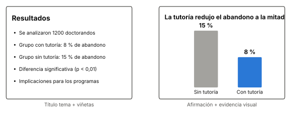

# Capítulo 4. Diseñar presentaciones {#sec-cap4}

::: {.callout-note appearance="default"}
## Objetivos
- Aplicar los principios de la percepción y la memoria al diseño de diapositivas.
- Usar el enfoque afirmación-evidencia: un título que afirma y una prueba visual que lo sostiene.
- Estructurar una charla científica según su duración y su público.
:::

::: {.callout-note appearance="simple" icon="false"}
## Glosario del capítulo
[Carga cognitiva](92-glosario.qmd#gl-carga) · [Afirmación-evidencia](92-glosario.qmd#gl-ae) · [Título afirmación](92-glosario.qmd#gl-tituloafirm) · [Principio de redundancia](92-glosario.qmd#gl-redundancia) · [Mensaje principal](92-glosario.qmd#gl-mensaje)
:::

::: {.callout-tip appearance="simple" icon="false"}
## Descargas
[Plantilla de entrega del reto (.qmd)](plantillas/entrega_reto.qmd){.btn .btn-outline-primary .btn-sm download="entrega_reto.qmd"}
[Tema de estilo (.scss)](plantillas/informe.scss){.btn .btn-outline-primary .btn-sm download="informe.scss"}
:::

## Lectura obligatoria

::: {.lectura}
Kosslyn, S. M.; Kievit, R. A.; Russell, A. G.; Shephard, J. M. (2012). [PowerPoint® presentation flaws and failures: A psychological analysis](https://doi.org/10.3389/fpsyg.2012.00230). *Frontiers in Psychology*, 3, 230.
:::

## 1. Diapositivas para cerebros humanos

Kosslyn et al. (2012) analizaron cientos de presentaciones y encontraron que la mayoría incumplía principios básicos de la psicología de la percepción, la memoria y la comprensión. Agrupan esos principios en tres objetivos:

| Objetivo | Principio | En la práctica |
|---|---|---|
| **Conectar con el público** | Relevancia; conocimiento apropiado | Solo lo necesario para el mensaje; definir lo que el público no sabe |
| **Dirigir y mantener la atención** | Cambio perceptible; diferencias destacadas | Lo importante resalta por tamaño, color o posición; nada se mueve sin motivo |
| **Facilitar la comprensión y la memoria** | Capacidad limitada; organización | Pocos elementos por diapositiva (unos cuatro bloques), agrupados y en orden |

La **carga cognitiva** es la clave: la memoria de trabajo es limitada. Una diapositiva con párrafos que el ponente además lee en voz alta compite consigo misma (**principio de redundancia**): el público no puede leer y escuchar a la vez el mismo texto con eficacia.

## 2. El enfoque afirmación-evidencia

Michael Alley y colaboradores proponen sustituir el esquema «título-tema + viñetas» por:

- Un **título afirmación**: una frase completa, de no más de dos líneas, que dice la conclusión de la diapositiva («La tutoría redujo el abandono a la mitad»), no el tema («Resultados»).
- Una **evidencia visual**: un gráfico, una imagen, un esquema que sostiene la afirmación, con las mínimas palabras.
- Las **explicaciones**, en la voz del ponente, no en la pantalla.

{#fig-c4-ae fig-alt="Dos diapositivas. La primera tiene el título «Resultados» y cinco viñetas de texto. La segunda tiene el título «La tutoría redujo el abandono a la mitad» y un gráfico de dos barras, 15 % sin tutoría y 8 % con tutoría."}

## 3. Estructurar la charla

| Duración | Estructura recomendada |
|---|---|
| **3 minutos** (por ejemplo, *Tesis en 3 minutos*) | Un problema, un hallazgo o una pregunta, por qué importa; una sola diapositiva |
| **10-15 minutos** (congreso) | Por qué importa (1-2 min) · qué hicimos (3-4) · qué encontramos (4-5) · qué significa (2) · mensaje final |
| **30-45 minutos** (seminario, defensa) | La anterior ampliada, con una o dos ideas por bloque y recapitulaciones |

Reglas que funcionan en todos los formatos:

- Escribe el **mensaje principal** en una frase antes de abrir el programa de diapositivas.
- Calcula aproximadamente **una diapositiva por minuto**, no más.
- Empieza por la pregunta, no por el índice.
- Termina con el mensaje principal en pantalla, no con «¿Preguntas?» o «Gracias».

## Actividades

::: {.clasificar #ia-c4-titulos titulo="¿Título tema o título afirmación?" categorias="Título tema|Título afirmación"}
- «Resultados» → Título tema
- «El sueño explica más varianza de la nota que las horas de estudio» → Título afirmación
- «Metodología» → Título tema
- «Las muestras de agua del río superan el límite legal de nitratos en verano» → Título afirmación
- «Análisis de los datos de 2024» → Título tema // Describe el contenido, no lo que se concluye.
- «Los modelos más grandes no mejoran la precisión con menos de 1000 ejemplos» → Título afirmación
:::

::: {.clasificar #ia-c4-kosslyn titulo="¿Qué principio de Kosslyn et al. se incumple?" categorias="Capacidad limitada|Relevancia|Diferencias destacadas|Redundancia"}
- Una diapositiva con 12 viñetas y dos gráficos → Capacidad limitada
- Incluir todos los detalles del protocolo en una charla para público general → Relevancia
- El dato clave tiene el mismo tamaño y color que todo lo demás → Diferencias destacadas
- El ponente lee palabra por palabra el texto de la diapositiva → Redundancia
:::

::: {.ordenar #ia-c4-charla titulo="Ordena una charla de congreso de 12 minutos"}
1. Por qué importa el problema
2. Qué pregunta concreta se abordó
3. Cómo se hizo
4. Qué se encontró
5. Qué significa y qué límites tiene
6. Mensaje principal para llevarse
:::

## Reto evaluable {#reto-c4}

::: {.callout-important appearance="simple" icon="false"}
## Reto del capítulo 4 · Rehaz tus diapositivas
1. Toma una presentación tuya reciente (o una de un congreso de tu campo).
2. Rehaz **cinco diapositivas** con el enfoque afirmación-evidencia.
3. Para cada una, explica qué principio de Kosslyn et al. (2012) aplicas.
4. Graba los dos minutos correspondientes con las nuevas diapositivas.

**Entrega:** las diapositivas antes y después, y el vídeo, con la [plantilla de entrega](plantillas/entrega_reto.qmd). Este reto **no tiene solución en el libro**.
:::

## Autoevaluación

Responde a todas las preguntas y pulsa **Mostrar respuestas**. No cuenta para la nota.

::: {.webex-check .webex-box}
1. Leer en voz alta el texto completo de la diapositiva facilita la comprensión. 
2. En el enfoque afirmación-evidencia, el título de la diapositiva es 
3. La limitación de la memoria de trabajo se relaciona con la carga 
4. Para una charla de 12 minutos, una regla razonable es 
5. La última diapositiva debería mostrar 
6. Kosslyn et al. (2012) encontraron que la mayoría de las presentaciones analizadas respetaban los principios psicológicos básicos. 
7. Hacer que lo importante destaque por tamaño, color o posición aplica el principio de diferencias 
8. ¿Qué conviene hacer antes de abrir el programa de diapositivas?


:::

::: {.webex-solution boton="Ver explicaciones"}
- Principio de redundancia.
- *Sentence headline*.
- *Cognitive load*.
- Aproximadamente una por minuto.
- Es lo que queda en pantalla durante las preguntas.
- La mayoría incumplía alguno.
- *Salience*.
- Todo lo demás se ordena en torno a ese mensaje.
:::
